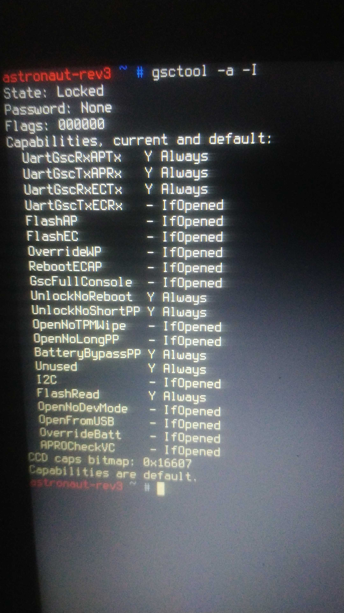
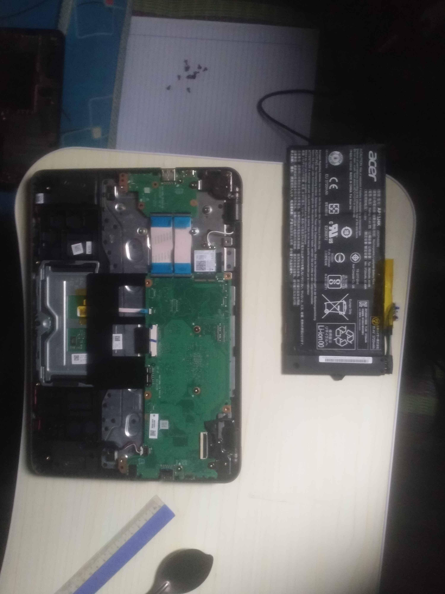

# chromebook-cr50-bypass

> [!CAUTION]
> Only proceed on devices you legally own

For some Chromebook with CR50 which couldn't boot straight from the wall charger, this method maybe could work

## Device

Acer C732
- N3350
- 32GB eMMC
- 4GB DDR4

Board name is `ASTRONAUT`

## Requirements

- Developer mode enabled

## Steps

1. Open VT2 shell (Use key combination for your specific model)

2. Run `gsctool -a -I` as shown in the picture:

3. Make sure `OverrideWP` atleast is set to `IfOpened`

4. Open the bottom cover and disconnect the battery

5. Plug in the wall charger, try to power on the Chromebook (It may flicker like we know)

6. Then just unplug it and put back the battery

7. Now try to power on the Chromebook (If it won't, just hold the power button for few seconds)

8. Now try to run MrChromeBox script, it may show as WP unlocked now

## Note

This method is inconsistent (mabye), but it worked for me
